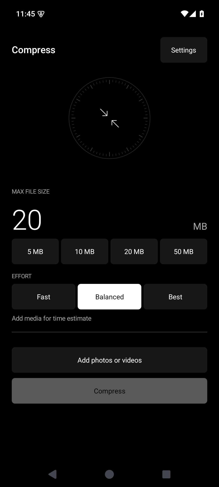

<h1> Compress</h1>

A minimal native Android photo and video compressor. Set a maximum file size, add media, and save to the local media library. Android 10 and newer.



## Install

Download **Compress-1.2.apk** from the [latest release](https://github.com/JackB-4/compress/releases/latest), open it on Android, and allow installation from that source. Install over the previous Compress APK to keep settings. Package: `com.jack.compress`; versionName: `1.2`; versionCode: `3`.

## Obtainium

<a href="https://apps.obtainium.imranr.dev/redirect?r=obtainium%3A%2F%2Fapp%2F%257B%2522id%2522%253A%2522com.jack.compress%2522%252C%2522url%2522%253A%2522https%253A%252F%252Fgithub.com%252FJackB-4%252Fcompress%2522%252C%2522author%2522%253A%2522JackB-4%2522%252C%2522name%2522%253A%2522Compress%2522%257D"></a>

In [Obtainium](https://github.com/ImranR98/Obtainium), add:

```
https://github.com/JackB-4/compress
```

Use the normal GitHub stable-release defaults. Releases contain one universal APK. Future releases must increment versionCode and retain the package and signing certificate. No architecture filter or GitHub token is required for this public repository. Obtainium device installation has not been tested.

## Features

- Maximum size per file in decimal MB, with 5/10/20/50 MB presets. Video/mixed queues default to 20 MB; photo-only queues default to 10 MB. Each remembers its own custom limit. The previous 10 MB video default migrates to 20 MB.
- Media picker, Android share-sheet input, URI drag/drop, and sequential queues.
- Native Media3 video encoding to H.264, HEVC, or AV1 video with AAC audio in MP4. Bitrate and resolution follow the size budget; oversized results are retried with lower settings.
- JPEG/WebP photo quality search, followed by dimension reduction when required.
- Fast/Balanced/Best effort controls and an estimated time range directly below the size controls.
- Files already below the limit can be copied without re-encoding.
- Dark, light, and system themes; compact tiles and dial details inspired by [Meridian](https://github.com/JackB-4/meridian).
- Frame-paced progress dial, converging arrows, smooth progress easing, completion checkmark, and screen transitions. Animations respect Android's system animation setting and stop when inactive.
- Foreground processing and cancellation; originals are preserved. Every result is byte-checked before publication.

## Saved files

Outputs are published through MediaStore to `Pictures/Compress` and `Movies/Compress`. Google Photos can show them under **Collections → On this device → Compress**. Cloud backup follows your Photos folder settings.

## Settings

Select **AV1** under Settings → Video codec. AV1 requires Android 14 or newer and an exposed native AV1 encoder. Hardware encoders are preferred; software is used when that is the only native option. Unsupported devices report an error. Codec selection is preserved rather than silently substituting H.264.

Theme, video codec, maximum video height, audio bitrate, audio removal, photo format, maximum photo edge, photo quality ceiling, and copying already-small files are configurable. Job options are snapshotted at start.

Effort controls change the processing strategy; they are not vendor-specific CPU-speed presets:

- **Fast:** up to 720p (or the lower configured limit), coarser photo quality search, one video corrective retry.
- **Balanced:** configured video ceiling, finer photo search, up to three corrective retries.
- **Best:** configured video ceiling, full photo search, up to five corrective retries, plus an extra video refinement pass when the first result leaves substantial unused size budget. A valid first result is retained if refinement fails.

Time estimates use media duration, planned resolution, codec and hardware availability. Initial factors are broad heuristics, not Pixel benchmarks. Estimates adapt from successful video jobs on the device, normalized by frame count and resolution. Thermal throttling, content complexity, retries and storage speed can change actual time. Photo estimates are approximate. Selecting a different effort updates the range. No estimate is shown until media is available.

## Privacy and limits

No network permission, ads, analytics, accounts, or uploads. Re-encoded photos omit source metadata and use SDR sRGB. Transparent images become white-backed JPEG unless WebP is selected; animated images become a still frame. Unchanged copies retain their original metadata.

Input support depends on Android/Media3 decoders on the device. Common JPEG, PNG, WebP, HEIC, MP4, MOV, WebM, and supported MKV tracks are accepted; arbitrary codecs and camera RAW are not guaranteed. HEVC depends on the encoder. Very small video budgets may be unattainable, especially with audio enabled; the app reports failure and publishes no oversized output. Retries always start from the original input.

Video percentages reflect the current encoder pass across the queue. Photo processing, size adjustment and saving are indeterminate. A retry may move progress backward. No device speed or perceptual-quality benchmark is claimed.

## Build

Windows PowerShell:

```powershell
./bootstrap.ps1
./build.ps1
```

Bootstrap verifies SHA-256-pinned Microsoft JDK 17 and Android command-line tool downloads, then installs SDK/build tools 35. Review and accept Google's SDK license when prompted. The Gradle wrapper uses Gradle 8.11.1 with a pinned distribution checksum. Media3 is pinned to 1.8.0.

Or open the project in Android Studio with JDK 17 and SDK 35. On Linux/macOS use `bash ./gradlew assembleRelease lintRelease` after configuring `ANDROID_HOME`. Output: `app/build/outputs/apk/release/app-release.apk`.

Release builds are non-debuggable and retain this machine's original development signing identity for compatibility with the first APK. The private keystore is excluded from this repository. A build on another machine creates/uses that machine's development identity and cannot update the published installation. CI artifacts are independently signed development builds, not replacement release APKs. Keep the original local signing key for future published updates.

## Validation

See [TESTING.md](TESTING.md). Published releases include `SHA256SUMS.txt` for integrity verification. Physical Pixel 10 Pro throughput, visual quality, Photos indexing, and Obtainium installation still require device testing.
